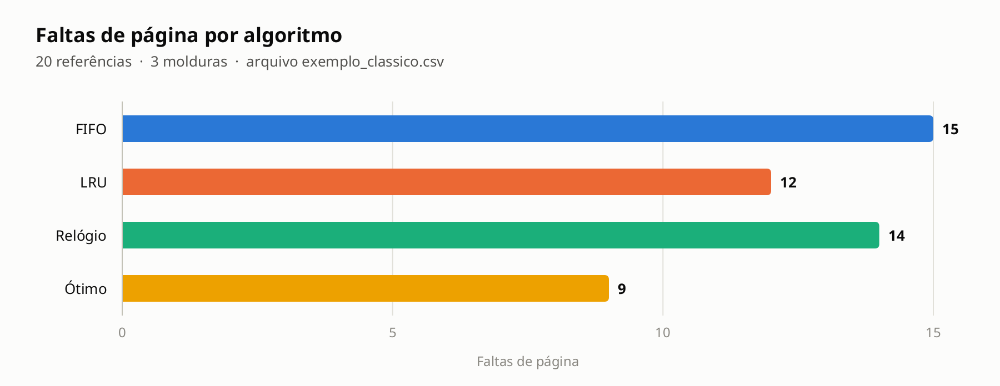
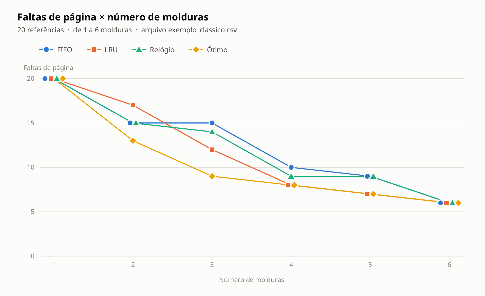
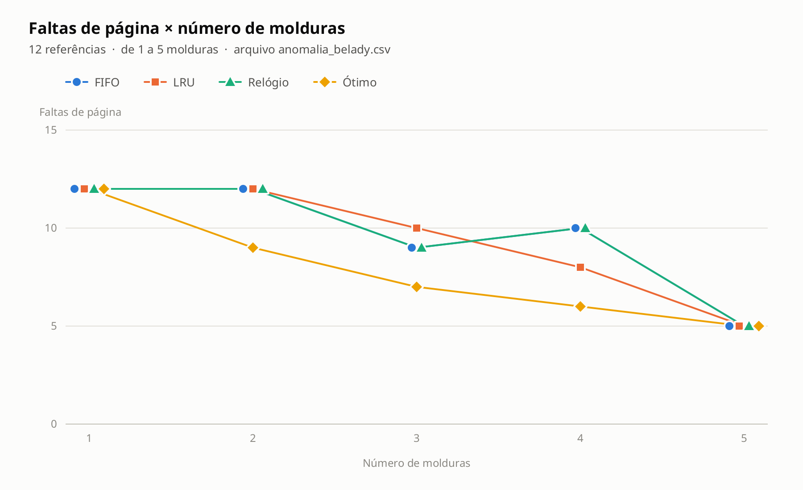
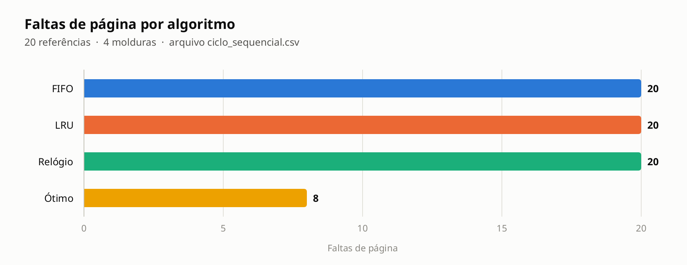
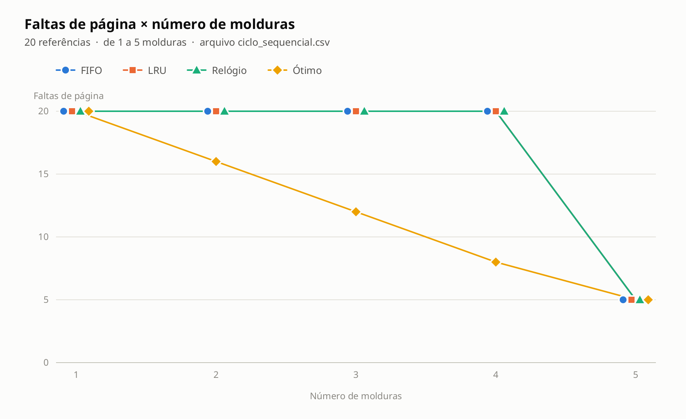
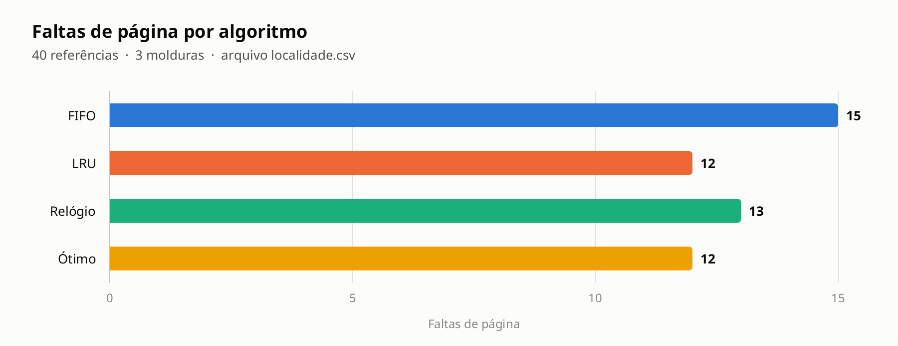
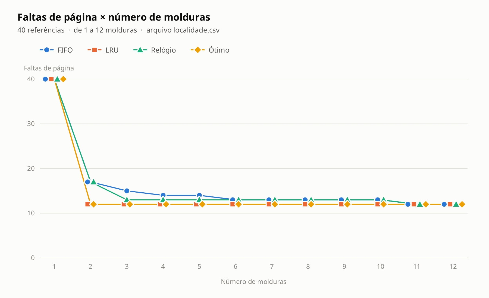
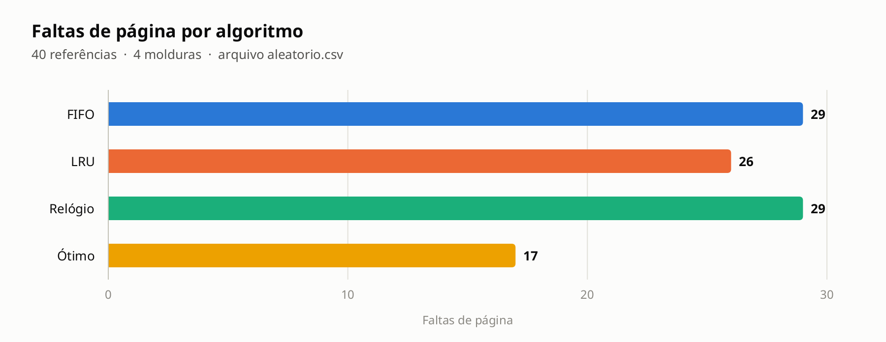
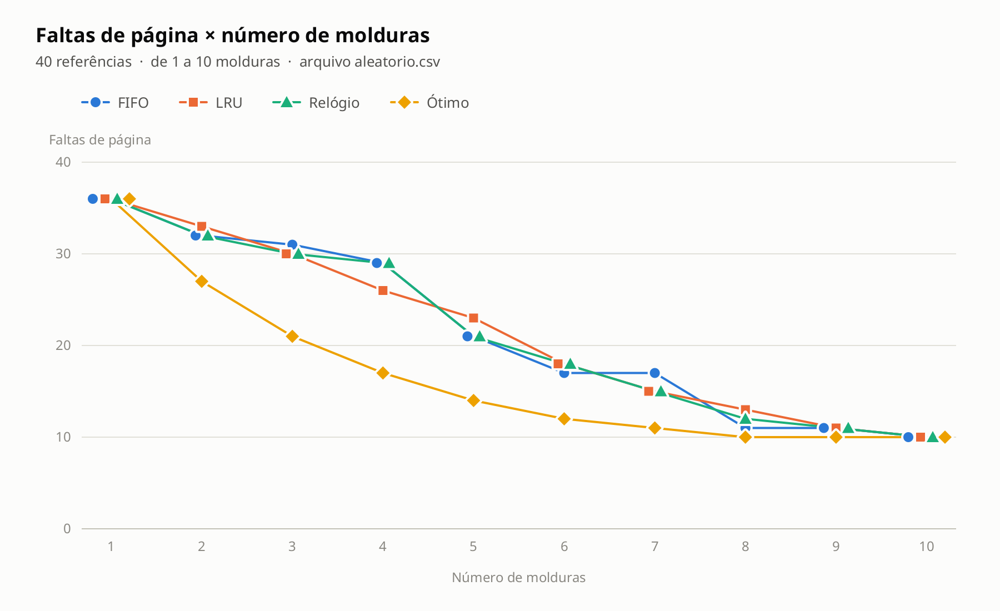

# Simulador de Algoritmos de Substituição de Páginas

**Disciplina:** Sistemas Operacionais
**Integrantes:** Manu () Thiago Elias (2315706)
**Professor(a):** Izequiel
**Data:** 27/10/2026

**Repositório no GitHub:** https://github.com/manuol14/trabalho_av2_simulador
**README (instruções de execução):** https://github.com/manuol14/trabalho_av2_simulador/blob/main/README.md

---

## Resumo

Este trabalho apresenta o desenvolvimento de um simulador, em Java, para avaliar o desempenho de algoritmos de substituição de páginas no gerenciamento de memória virtual. Dos seis algoritmos estudados em sala (FIFO, LRU, Relógio, Ótimo, NFU e Envelhecimento), foram implementados quatro: **FIFO**, **LRU**, **Relógio** e **Ótimo**. O simulador lê a cadeia de referência a partir de um arquivo CSV, calcula o número de faltas de página de cada método e gera gráficos comparativos. Foram analisados cinco cenários com características diferentes. O algoritmo Ótimo obteve o menor número de faltas em todos eles, como esperado. O LRU foi o que mais se aproximou do Ótimo quando a cadeia tinha localidade de referência, chegando a empatar com ele. O FIFO, além de ter o pior resultado na maioria dos casos, apresentou a anomalia de Belady.

## 1. Introdução

Em um sistema com memória virtual, os processos enxergam um espaço de endereçamento maior do que a memória física disponível. A memória física é dividida em molduras (*frames*) e o espaço lógico em páginas. Quando um processo acessa uma página que não está em nenhuma moldura, ocorre uma **falta de página** (*page fault*), e o sistema operacional precisa buscá-la no disco. Se todas as molduras estiverem ocupadas, uma das páginas presentes deve ser escolhida para sair. Essa escolha é feita pelo **algoritmo de substituição de páginas**.

Cada falta de página tem um custo alto, pois envolve acesso ao disco, que é muito mais lento que a memória principal. Por isso, a política de substituição afeta diretamente o desempenho do sistema. Uma boa política tenta manter na memória as páginas que serão usadas em breve e retirar as que não serão mais necessárias.

## 2. Objetivos

- Desenvolver um simulador que receba uma cadeia de números inteiros representando as páginas referenciadas.
- Implementar quatro algoritmos de substituição de páginas e informar a quantidade de faltas de página de cada um, no formato `Método N - X faltas de página`.
- Permitir que a cadeia de referência seja lida de um arquivo CSV, facilitando testar diferentes cenários.
- Gerar gráficos que permitam comparar visualmente o desempenho dos algoritmos.
- Analisar em quais situações cada algoritmo é mais adequado.

## 3. Algoritmos implementados

### 3.1 FIFO (First In, First Out)

Substitui a página que está há mais tempo na memória, independentemente de ela ter sido usada recentemente. Na implementação, um `HashSet` guarda as páginas presentes na memória (para a busca ser rápida) e uma fila (`ArrayDeque`) guarda a ordem de chegada. Na falta de página com a memória cheia, a página do início da fila é removida.

### 3.2 LRU (Least Recently Used)

Substitui a página que foi usada há mais tempo. A implementação usa uma lista ordenada pelo último uso: quando uma página é acessada, ela é movida para o final da lista. Assim, o início da lista sempre contém a página menos recentemente usada, que é a escolhida na substituição.

### 3.3 Relógio (Clock / segunda chance)

É uma aproximação do LRU com custo menor. As molduras formam uma lista circular, e cada uma tem um **bit de referência**. Quando a página é acessada, o bit recebe 1. Na falta de página, o ponteiro do relógio percorre as molduras: se o bit for 1, ele é zerado (a página ganha uma "segunda chance") e o ponteiro avança; se o bit for 0, a página é substituída. Na implementação foram usados um vetor de molduras, um vetor de `boolean` para os bits e um índice como ponteiro circular.

### 3.4 Ótimo

Substitui a página que vai demorar mais para ser usada de novo, ou que não será mais usada. Para isso, na falta de página, o algoritmo procura na parte restante da cadeia o próximo uso de cada página da memória e escolhe a que estiver mais distante. Ele não pode ser usado em um sistema real, porque exige conhecer os acessos futuros, mas serve de **referência** (limite inferior) para avaliar os outros.

## 4. Metodologia

O simulador foi desenvolvido em **Java**, sem bibliotecas externas. Todos os algoritmos implementam a mesma interface, `PageReplacementAlgorithm`, com o método `int run(int[] pages, int frameCapacity)`, que recebe a cadeia de referência e a quantidade de molduras e devolve o número de faltas de página. As classes do projeto são:

| Classe | Responsabilidade |
|---|---|
| `SimuladorMemoria` | Programa principal: lê os parâmetros, executa os algoritmos e imprime os resultados |
| `FifoAlgorithm`, `LruAlgorithm`, `ClockAlgorithm`, `OptimalAlgorithm` | Os quatro métodos de substituição |
| `LeitorCsv` | Lê a cadeia de referência de um arquivo CSV |
| `GeradorGraficos` | Desenha os gráficos com Java2D e salva em PNG |

**Entrada.** A cadeia de referência é lida de um arquivo CSV. O leitor aceita números separados por vírgula, ponto e vírgula, espaço ou quebra de linha, ignora comentários (linhas iniciadas por `#`) e um cabeçalho opcional, e avisa a linha exata quando encontra um valor inválido. O arquivo e a quantidade de molduras são passados como argumentos (`java -cp out SimuladorMemoria entradas/aleatorio.csv 4`). Sem argumentos, o programa usa `entradas/exemplo_classico.csv` com 3 molduras.

**Saída.** Para a quantidade de molduras escolhida, o programa imprime o número de faltas de cada método. Em seguida, executa os quatro algoritmos novamente variando o número de molduras de 1 até a quantidade de páginas distintas da cadeia, imprime essa tabela e gera dois gráficos:

1. **Faltas de página por algoritmo** (barras), com a quantidade de molduras escolhida;
2. **Faltas de página × número de molduras** (linhas), mostrando como cada algoritmo se comporta conforme a memória aumenta.

**Cenários de teste.** Foram montados cinco arquivos CSV, cada um com uma característica de acesso diferente:

| Cenário | Arquivo | Referências | Páginas distintas | Molduras | Característica |
|---|---|---:|---:|---:|---|
| Exemplo clássico | `exemplo_classico.csv` | 20 | 6 | 3 | Cadeia usada nos livros de SO |
| Anomalia de Belady | `anomalia_belady.csv` | 12 | 5 | 3 | Cadeia clássica para mostrar a anomalia |
| Ciclo sequencial | `ciclo_sequencial.csv` | 20 | 5 | 4 | Laço que percorre 5 páginas com só 4 molduras |
| Localidade | `localidade.csv` | 40 | 12 | 3 | Página 0 usada o tempo todo + páginas de dados que avançam aos poucos |
| Aleatório | `aleatorio.csv` | 40 | 10 | 4 | Páginas sorteadas entre 0 e 9 (sem localidade) |

## 5. Resultados

### 5.1 Resumo

| Cenário | Molduras | FIFO | LRU | Relógio | Ótimo |
|---|---:|---:|---:|---:|---:|
| Exemplo clássico | 3 | 15 | 12 | 14 | **9** |
| Anomalia de Belady | 3 | 9 | 10 | 9 | **7** |
| Ciclo sequencial | 4 | 20 | 20 | 20 | **8** |
| Localidade | 3 | 15 | **12** | 13 | **12** |
| Aleatório | 4 | 29 | 26 | 29 | **17** |

### 5.2 Exemplo clássico

Saída do programa:

```text
Método 1 - FIFO - 15 faltas de página
Método 2 - LRU - 12 faltas de página
Método 3 - Relógio - 14 faltas de página
Método 4 - Ótimo - 9 faltas de página
```





Com 3 molduras, a ordem foi Ótimo (9) < LRU (12) < Relógio (14) < FIFO (15), que é o resultado esperado pela teoria: o Relógio fica entre o FIFO e o LRU porque é uma aproximação do LRU. Os valores do FIFO, do LRU e do Ótimo batem com os apresentados na literatura para essa cadeia, o que ajudou a validar as implementações. O gráfico de linhas mostra que, com 2 molduras, o LRU (17) foi pior que o FIFO e o Relógio (15). Ou seja, o LRU não é melhor em todos os casos. A partir de 6 molduras todos chegam a 6 faltas, que é o número de páginas distintas (faltas obrigatórias, que acontecem na primeira vez que cada página é carregada).

### 5.3 Anomalia de Belady

| Molduras | FIFO | LRU | Relógio | Ótimo |
|---:|---:|---:|---:|---:|
| 3 | 9 | 10 | 9 | 7 |
| 4 | **10** | 8 | **10** | 6 |



Esse cenário mostra a **anomalia de Belady**: no FIFO, ao aumentar a memória de 3 para 4 molduras, o número de faltas **subiu** de 9 para 10. O mesmo aconteceu com o Relógio, que também se baseia na ordem de chegada das páginas. O LRU e o Ótimo nunca apresentam essa anomalia, porque são *algoritmos de pilha*: o conjunto de páginas na memória com *n* molduras está sempre contido no conjunto com *n + 1* molduras. Isso aparece no gráfico: as curvas do LRU e do Ótimo só descem, enquanto as do FIFO e do Relógio sobem entre 3 e 4 molduras. Também chama atenção que, com 3 molduras, o LRU (10) foi pior que o FIFO (9).

### 5.4 Ciclo sequencial





A cadeia repete o laço 1, 2, 3, 4, 5 quatro vezes, com apenas 4 molduras. Esse é o pior caso para o LRU: a página que ele remove (a usada há mais tempo) é justamente a próxima a ser acessada. Por isso FIFO, LRU e Relógio tiveram falta em **todas** as 20 referências, enquanto o Ótimo teve só 8. O gráfico de linhas mostra que FIFO, LRU e Relógio continuam com 20 faltas de 1 a 4 molduras e só melhoram quando a memória comporta o laço inteiro (5 molduras). O cenário mostra que, quando o conjunto de trabalho é um pouco maior que a memória, aumentar um pouco a memória não ajuda nada.

### 5.5 Localidade de referência





Aqui a página 0 é acessada a cada duas referências (como o código de um laço) e as páginas de dados avançam aos poucos. É o tipo de comportamento comum em programas reais. O **LRU empatou com o Ótimo** (12 faltas), pois ele nunca remove a página 0, que é sempre recente. O Relógio (13) ficou próximo, já que o bit de referência da página 0 está quase sempre ligado e ela recebe a segunda chance. O FIFO (15) teve o pior resultado, porque de tempos em tempos remove a página 0 só por ela ter sido a primeira a entrar e precisa carregá-la de novo logo depois. Pelo gráfico de linhas, o FIFO só alcança o LRU com 11 molduras, enquanto o LRU já atinge o mínimo com 2.

### 5.6 Cadeia aleatória





Sem localidade de referência, o histórico de uso não ajuda a prever os próximos acessos. Por isso FIFO (29), LRU (26) e Relógio (29) ficaram próximos entre si e bem distantes do Ótimo (17). O gráfico de linhas mostra as curvas dos três se cruzando várias vezes: com 4 molduras o LRU foi o melhor, mas com 5 molduras FIFO e Relógio (21) foram melhores que o LRU (23). Neste cenário nenhum dos três algoritmos práticos é claramente superior.

## 6. Conclusão

O simulador cumpriu o objetivo de comparar os algoritmos de substituição de páginas a partir de cadeias de referência lidas de arquivos CSV, e os gráficos gerados facilitaram a análise. A partir dos resultados, conclui-se que:

- O **Ótimo** teve o menor número de faltas em todos os cenários e funciona como limite inferior para comparar os demais, mas não pode ser implementado na prática.
- O **LRU** foi o melhor algoritmo prático quando a cadeia tem localidade de referência, chegando a empatar com o Ótimo. Porém, tem pior caso em laços maiores que a memória e não superou o FIFO em todas as situações. Seu custo é manter a ordem de uso a cada acesso.
- O **Relógio** não foi pior que o FIFO em nenhum dos cenários (com a quantidade de molduras escolhida) e, quando havia localidade, ficou próximo do LRU. Ele consegue boa parte do benefício do LRU usando só um bit por moldura, o que explica por que variações dele são usadas em sistemas operacionais reais.
- O **FIFO** é o mais simples, mas foi o pior na maioria dos cenários e apresentou a anomalia de Belady (mais memória gerando mais faltas).
- Em todos os algoritmos, aumentar o número de molduras reduz as faltas até o limite das faltas obrigatórias (uma por página distinta). O ganho depende muito do padrão de acesso, como mostrou o cenário do ciclo sequencial.

Assim, não existe um algoritmo melhor em todos os casos: o padrão de acesso do programa determina qual política funciona melhor. Na prática, algoritmos que aproximam o LRU com baixo custo, como o Relógio, oferecem o melhor equilíbrio entre desempenho e custo de implementação.

## Referências

- TANENBAUM, Andrew S.; BOS, Herbert. **Sistemas Operacionais Modernos**. 4. ed. São Paulo: Pearson, 2016.
- SILBERSCHATZ, Abraham; GALVIN, Peter B.; GAGNE, Greg. **Fundamentos de Sistemas Operacionais**. 9. ed. Rio de Janeiro: LTC, 2015.
- BELADY, L. A.; NELSON, R. A.; SHEDLER, G. S. An anomaly in space-time characteristics of certain programs running in a paging machine. **Communications of the ACM**, v. 12, n. 6, p. 349–353, 1969.
